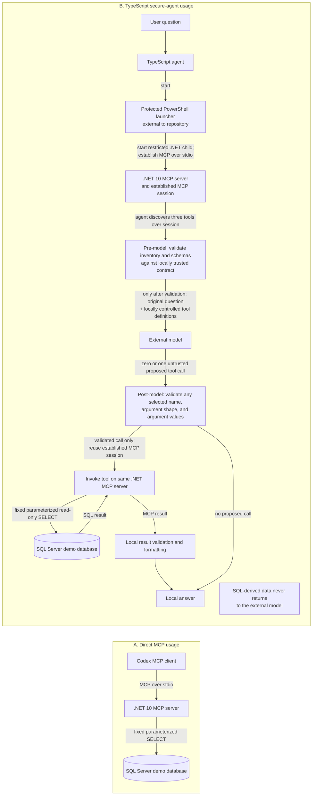

# McpSqlDemo

McpSqlDemo is an engineering demonstration of a **read-only .NET 10 Model Context Protocol (MCP) server backed by SQL Server** and a **TypeScript agent that uses an external model only for constrained tool selection**. It combines exact local tool allowlisting, strict argument validation, fixed parameterized SQL, bounded local result validation, and deterministic local formatting so that **SQL-derived data is never returned to the external model**.

The repository emphasizes defense-in-depth security and explicit privacy boundaries. It also provides an architectural blueprint for integrating MCP with legacy .NET Framework applications without coupling the legacy runtime to the MCP host. This is a portfolio-scale engineering demonstration—not a production-ready enterprise platform—and uses only local demo shipment data.

## Architecture at a glance

Two implemented entry paths share the same .NET MCP server:



The protected launcher is a separately managed Windows/DPAPI-specific process boundary and is not stored in this repository. In the secure-agent path, the model receives the original question, fixed instructions, and locally controlled tool definitions. MCP discovery, execution, SQL access, result validation, and formatting remain local. See [Trust boundaries and data flow](docs/architecture/trust-boundaries.md) and [ADR-0001](docs/architecture/adr/0001-model-selection-without-data-feedback.md).

## What is implemented

- A local .NET 10/C# MCP server using stdio and dependency injection.
- Three read-only shipment tools: `list_shipments`, `get_shipment_by_id`, and `get_shipments_by_status`.
- Fixed, parameterized SQL Server queries; list operations return at most 20 records.
- A strict TypeScript/Node.js MCP client and OpenAI Responses API tool-selection agent.
- Exact discovered-tool allowlisting, structural schema checks, independent selected-argument validation, and at-most-one tool execution.
- Local size, shape, field, value, and control-character validation followed by deterministic formatting.
- Bounded deadlines, concurrency, cancellation, model retries, and sanitized diagnostics.
- .NET and TypeScript unit, integration, contract, resilience, and adversarial security tests plus offline CI.

## Key engineering decisions

| Decision | Engineering intent |
| --- | --- |
| [Model selection without data feedback](docs/architecture/adr/0001-model-selection-without-data-feedback.md) | The external model selects zero or one tool; SQL/MCP results are never sent back for summarization or follow-up. |
| [Strict MCP contract validation](docs/architecture/mcp-contract-versioning.md) | The agent requires the exact three-tool set and accepted schemas, then independently validates the selected name and arguments. |
| Layered validation | The MCP tools revalidate inputs; the agent bounds question, arguments, tool-result bytes, records, fields, types, values, and display text. |
| Parameterized, bounded, read-only SQL | Repository methods contain fixed `SELECT` statements with typed parameters and `TOP (20)` bounds; no arbitrary SQL or write tool exists. |
| Least-privilege database access | SQL identity and effective permissions are independently configurable and testable; read-only intent is not a substitute for database authorization. |
| Prompt-injection and tool-poisoning defenses | User text is untrusted, model output has no authority, discovered descriptions are not forwarded to the model, and adversarial labs test unsafe alternatives. |
| Bounded reliability | Initialization, model, tool, overall, connection, and command timeouts combine with cancellation, a concurrency gate, and at most one narrowly eligible model retry. |
| Privacy-conscious diagnostics | Diagnostics are off by default and use allowlisted operational fields; questions, arguments, payloads, SQL data, secrets, raw errors, and sensitive paths are excluded. |
| Dependency injection and testable boundaries | Repository, model-router, MCP-gateway, clock/delay, and diagnostics abstractions allow isolated deterministic tests. |
| Offline verification | CI needs no SQL Server, launcher, DPAPI material, API key, or live model call after dependency restore; security labs exercise prompt injection and tool poisoning. |

Security controls and residual risks are documented in [Trust boundaries and data flow](docs/architecture/trust-boundaries.md). Contract evolution rules are in [MCP contract versioning](docs/architecture/mcp-contract-versioning.md).

## Technology stack

| Technology | Responsibility in this repository |
| --- | --- |
| .NET 10 / C# | MCP host, shipment tools, validation, execution policy, and SQL repository |
| MCP SDK and stdio | Local tool discovery and cross-process tool invocation |
| SQL Server / `Microsoft.Data.SqlClient` | Local demo data and fixed parameterized reads |
| TypeScript / Node.js | Strict MCP client, secure-agent orchestration, validation, formatting, and diagnostics |
| OpenAI Responses API | Constrained natural-language selection of zero or one locally defined tool |
| Microsoft Dependency Injection | Runtime composition and replaceable/testable server boundaries |
| xUnit and TypeScript tests | Unit, integration, protocol, resilience, privacy, and adversarial verification |
| GitHub Actions | Offline build, typecheck, and test workflow on Ubuntu |

## Implemented demo vs. proposed enterprise architecture

| Implemented in this repository | Proposed / not implemented |
| --- | --- |
| Local read-only MCP server | Trusted authentication/session host |
| Three bounded shipment tools | Tenant-aware authorization and secure identity propagation |
| TypeScript tool-selection agent | Enterprise Anti-Corruption Layer (ACL) |
| Local contract/result validation and formatting | Legacy application-service integration |
| Existing .NET, TypeScript, protocol, and adversarial tests plus CI | Strangler Fig rollout, feature-flag, deployment, and rollback infrastructure |

The proposed components are design guidance only and are deliberately excluded from the implemented architecture diagram above. See the [Legacy Enterprise Integration Blueprint](docs/architecture/legacy-integration-blueprint.md) for the out-of-process .NET Framework approach, authorization ownership, ACL boundary, and incremental rollout design.

## Limitations and security boundaries

- The original user question is sent to the external model and may itself contain sensitive information. Character limits are not data classification.
- `store: false` is requested, but it is not a complete privacy guarantee and does not eliminate provider processing, legal, retention, residency, abuse-monitoring, or operational considerations.
- The demo has no multi-user authentication, trusted session host, tenant establishment, tenant-aware authorization, or row-level enterprise policy.
- The protected launcher is external to this repository and is Windows/DPAPI-specific; its identity, ACLs, script integrity, secret handling, and deployment remain separate responsibilities.
- A structurally valid model selection can still be semantically incorrect, incomplete, or return no tool.
- The agent's 64 KiB tool-result check occurs after the response has been received; it is an acceptance bound, not a transport-buffer or pre-allocation limit.
- No production enterprise integration, application-service endpoint, ACL, rollout infrastructure, or production data path exists.
- Read-only tools reduce capability but do not eliminate unauthorized reads, excessive disclosure, injection in displayed data, credential compromise, poisoned metadata, or denial-of-service risks.

Do not point this project at a production TMS or company database. Production consideration would require threat modeling, authentication and authorization, data classification, validated TLS, host hardening, audit policy, pagination/rate limits, deployment controls, and enterprise integration review.

## Repository map

| Path | Purpose |
| --- | --- |
| [`src/McpSqlDemo`](src/McpSqlDemo) | .NET 10 MCP server, tools, validation, execution policy, and SQL repository |
| [`tests/McpSqlDemo.Tests`](tests/McpSqlDemo.Tests) | .NET unit, integration, permission, and stdio protocol tests |
| [`clients/typescript`](clients/typescript) | TypeScript MCP client and secure agent; see its [README](clients/typescript/README.md) |
| [`sql`](sql) | Local demo database and optional least-privilege identity setup scripts |
| [`labs/PromptInjectionLab`](labs/PromptInjectionLab) | Deliberately unsafe prompt-injection lab and [explanation](labs/PromptInjectionLab/README.md) |
| [`labs/ToolPoisoningLab`](labs/ToolPoisoningLab) | Deliberately unsafe tool-poisoning lab and [explanation](labs/ToolPoisoningLab/README.md) |
| [`docs/architecture`](docs/architecture) | [Legacy blueprint](docs/architecture/legacy-integration-blueprint.md), [trust boundaries](docs/architecture/trust-boundaries.md), [contract versioning](docs/architecture/mcp-contract-versioning.md), and [ADR-0001](docs/architecture/adr/0001-model-selection-without-data-feedback.md) |
| [`.github/workflows/ci.yml`](.github/workflows/ci.yml) | Offline build and test workflow |

## Prerequisites

- .NET 10 SDK (`dotnet --version`). Recent Visual Studio 2022 tooling may not support targeting .NET 10, so use a compatible IDE/SDK or the CLI.
- SQL Server Developer/Express or another local SQL Server instance, plus SSMS.
- Codex CLI or a Codex IDE extension that supports MCP for direct MCP use.
- Node.js 20 or newer for the TypeScript client and secure agent (Node.js 22 LTS is tested locally).
- The separately managed protected PowerShell launcher for TypeScript client or agent operations.

## Local setup

### 1. Create the demo database

Run [`sql/setup.sql`](sql/setup.sql) in SSMS against your **local test instance**.

### 2. Restore and build the MCP server

From the repository root in PowerShell:

```powershell
dotnet restore .\src\McpSqlDemo\McpSqlDemo.csproj
dotnet build .\src\McpSqlDemo\McpSqlDemo.csproj -c Release
```

NuGet references are pinned to explicit versions for repeatable restores.

### 3. Configure the SQL connection

For first-time local testing with Windows authentication:

```powershell
$env:MCP_SQL_CONNECTION = 'Server=localhost;Database=McpSqlDemo;Integrated Security=True;Encrypt=True;TrustServerCertificate=True;Application Name=McpSqlDemo;'
```

Change `Server` for your own **local** SQL Server instance, for example `localhost\SQLEXPRESS`. In a real deployment, use validated TLS certificates (avoid `TrustServerCertificate=True`) and read-only SQL permissions. Set this environment variable for the server process rather than storing credentials in the repository.

Windows Integrated Security remains the default local-development path. The optional SQL-authenticated identity below does not replace or automatically modify this configuration.

#### Optional least-privilege SQL login

All setup in this section is manual and must be reviewed first. Neither the application nor the tests create logins, users, or permissions.

1. Connect to the intended local instance in SSMS using an administrative Windows identity and check the instance type and authentication mode:

   ```sql
   SELECT
       SERVERPROPERTY(N'IsLocalDB') AS IsLocalDB,
       SERVERPROPERTY(N'IsIntegratedSecurityOnly') AS IsWindowsAuthenticationOnly;
   ```

   `IsWindowsAuthenticationOnly = 0` means the endpoint accepts both Windows and SQL Server authentication. `1` means a SQL login will not work there. LocalDB commonly uses Integrated Security, so check rather than assume. See [`SERVERPROPERTY`](https://learn.microsoft.com/sql/t-sql/functions/serverproperty-transact-sql) and [SQL Server Express LocalDB](https://learn.microsoft.com/sql/database-engine/configure-windows/sql-server-express-localdb).

2. If the result is `1`, do not weaken or patch LocalDB solely for this lab. Keep Integrated Security and run the MCP process under a dedicated Windows account with only object-level `SELECT`, or use a normal local SQL Server Express/Developer instance deliberately configured for mixed mode. Keep Windows authentication for administration. [Changing server authentication mode](https://learn.microsoft.com/sql/database-engine/configure-windows/change-server-authentication-mode) is an explicit administrator action and normally requires restarting SQL Server.

3. If the result is `0`, use **SSMS Object Explorer > Security > Logins > New Login** to create a SQL Server login named `mcp_app_reader`. Generate a unique strong password in an approved local password/secret manager and paste it into SSMS. Do not put it in a `.sql` file, shell history, source control, issue, chat, or screenshot. Leave only the implicit `public` server role selected; do not select `sysadmin` or another server role. Do not enable or use `sa`.

4. Review and manually run [`sql/setup-mcp-app-reader.sql`](sql/setup-mcp-app-reader.sql) on that instance. It creates the mapped database user when needed, rejects unexpected role membership or permissions, grants only object-level `SELECT` on `dbo.Shipments`, and explicitly denies `INSERT`, `UPDATE`, `DELETE`, and `ALTER`. It never uses `db_owner`, `db_datareader`, a schema-level grant, a password, or dynamic SQL.

5. Construct the MCP connection at process startup with `User ID=mcp_app_reader`, the password read from the secret manager, `Integrated Security=False`, encryption enabled, and the `McpSqlDemo` database selected. Validate the server certificate outside throwaway local development. Do not echo the value or pass it as a command-line argument.

Store the credential outside this repository in an OS-backed or organization-approved secret manager, scoped to the account that launches Codex/MCP. Prefer a short launcher that reads the secret, constructs `MCP_SQL_CONNECTION` only in the current process environment, starts Codex, and clears its local variables. Do not use `setx`, a committed settings file, an MCP registration command containing the connection string, or an `.env` file as a password store. Environment variables can still be inspected by sufficiently privileged same-user processes, so restrict account access and rotate an exposed credential. Application and test failures intentionally omit connection strings, passwords, and raw SQL Server error messages; preserve that behavior when adding diagnostics.

Optional security limits use safe defaults and remain bounded when larger values are configured:

| Environment variable | Default | Allowed range |
| --- | ---: | ---: |
| `MCP_SQL_CONNECTION_TIMEOUT_SECONDS` | 5 seconds | 1–30 seconds |
| `MCP_SQL_COMMAND_TIMEOUT_SECONDS` | 10 seconds | 1–120 seconds |
| `MCP_TOOL_EXECUTION_DEADLINE_SECONDS` | 15 seconds | 1–120 seconds |
| `MCP_TOOL_MAX_CONCURRENCY` | 4 calls | 1–16 calls |

Invalid non-numeric values fall back to the default; numeric values outside the range are clamped to the nearest bound. The execution deadline includes time waiting for a concurrency permit.

### 4. Register the server with Codex

Compile first. From PowerShell in the same session where the passwordless Integrated Security `MCP_SQL_CONNECTION` was set:

```powershell
codex mcp add mcp-sql-demo --env MCP_SQL_CONNECTION="$env:MCP_SQL_CONNECTION" -- dotnet "C:\path\to\McpSqlDemo\src\McpSqlDemo\bin\Release\net10.0\McpSqlDemo.dll"
codex mcp list
```

Replace the absolute path with the actual location. **Do not use a SQL password in a command line**: arguments and configuration can be visible. If a connection string contains secrets, configure it through a secure environment mechanism and restrict file access. Restart Codex or the IDE after registering.

The `--env` example is for passwordless Integrated Security only. For SQL authentication, register the server command without embedding `MCP_SQL_CONNECTION`; launch Codex through the reviewed secret-loading mechanism so the MCP child inherits the process-scoped variable. If the client cannot safely inherit or retrieve the secret, keep Integrated Security instead of persisting a password in MCP configuration.

### 5. Exercise direct MCP usage

Ask Codex: `Using mcp-sql-demo, list demo shipments.` Then ask: `Get shipment with ID 2.`

If the tools are not visible, review `codex mcp list`, confirm the .NET 10 runtime is installed, run `dotnet build`, and check the SQL connection. A stdio MCP server appears to hang if started directly because it is waiting for JSON-RPC messages; that is normal.

## TypeScript MCP client and secure agent

The client starts the server only through the external protected PowerShell launcher. It does not need direct access to DPAPI material or SQL configuration. On Windows it preserves the MCP SDK's restricted default child environment and additionally forwards only `PATHEXT`, which PowerShell needs for executable resolution.

From `clients/typescript`, install and run offline checks:

```powershell
npm ci
npm run typecheck
npm run build
npm test
```

Set only the launcher's absolute `.ps1` path in the current process; never put credentials, a connection string, or DPAPI payload in this variable or in command arguments:

```powershell
$env:MCP_SERVER_LAUNCHER_PATH = 'C:\path\outside\the\repository\start-mcp.ps1'
```

Direct TypeScript MCP client commands are:

```powershell
npm run dev -- list
npm run dev -- get 1
npm run dev -- status Pending
npm run dev -- tools
```

The secure agent uses the official OpenAI TypeScript SDK and Responses API:

```powershell
npm run agent -- "Show me all pending shipments"
```

The model recognizes intent and selects at most one locally defined function. The client independently validates the discovered MCP allowlist and schemas, selected tool and arguments, and bounded shipment result. SQL-derived results are formatted locally and never sent back to the model.

The default approved model is the pinned `gpt-5.4-mini-2026-03-17` snapshot. `OPENAI_MODEL` may be set only to that snapshot or `gpt-5.4-mini`. Requests set `store: false`, `parallel_tool_calls: false`, SDK `maxRetries: 0`, and a maximum of 256 output tokens per provider attempt. See [Secure AI tool selection](clients/typescript/README.md#secure-ai-tool-selection-phase-4b) for full configuration, limits, security behavior, API-key-free checks, and manual live-test instructions.

### Secure-agent diagnostics

Set `MCP_AGENT_DIAGNOSTICS=1` only for the current process to emit sanitized JSON Lines events to stderr; diagnostics are otherwise disabled and shipment output remains on stdout:

```powershell
$env:MCP_AGENT_DIAGNOSTICS = '1'
npm run agent -- "Show me all pending shipments"
Remove-Item Env:MCP_AGENT_DIAGNOSTICS -ErrorAction SilentlyContinue
```

One locally generated correlation ID connects initialization, model selection, optional MCP execution, validation/formatting, and completion. Questions, prompts, arguments, model/MCP payloads, shipment or SQL data, secrets, raw failures, and sensitive paths are excluded by construction. See [Secure local diagnostics](clients/typescript/README.md#secure-local-diagnostics-phase-5a).

### Model resilience

The agent uses one model attempt by default. Setting `MCP_MODEL_MAX_ATTEMPTS=2` permits at most one retry, only for validated OpenAI SDK HTTP 429/500/502/503/504 failures and only within the original 20-second model-stage deadline. The retry wrapper never includes MCP initialization, tool execution, SQL, validation, or formatting, and the request still executes at most one MCP tool. See [Secure AI tool selection](clients/typescript/README.md#secure-ai-tool-selection-phase-4b) for exact backoff, deadline, diagnostics, and non-retry rules.

## Verification overview

The table lists only commands supported by this repository. “Offline” means no SQL, protected launcher, or OpenAI request; dependency restore/install may still require package feeds when caches are cold.

| Existing command | Offline | SQL Server | Protected launcher | OpenAI API |
| --- | :---: | :---: | :---: | :---: |
| `dotnet test .\tests\McpSqlDemo.Tests\McpSqlDemo.Tests.csproj --filter "Category!=Integration"` | Yes | No | No | No |
| `dotnet test .\labs\PromptInjectionLab.Tests\PromptInjectionLab.Tests.csproj` | Yes | No | No | No |
| `dotnet test .\labs\ToolPoisoningLab.Tests\ToolPoisoningLab.Tests.csproj` | Yes | No | No | No |
| `npm run typecheck`, `npm run build`, `npm test` from `clients/typescript` | Yes | No | No | No |
| `dotnet test .\tests\McpSqlDemo.Tests\McpSqlDemo.Tests.csproj --filter "Category=Integration"` | No | Yes | No | No |
| Opt-in `LeastPrivilegeSqlAuthenticationIntegrationTests` command below | No | Yes | No | No |
| Opt-in `McpStdioIntegrationTests.ListShipments_ThroughStdio_ReturnsValidShipmentData` command below | No | Yes | No | No |
| `npm run dev -- tools` | No | No | Yes | No |
| `npm run dev -- list` (or `get`, `status`) | No | Yes | Yes | No |
| `npm run agent -- "Show me all pending shipments"` | No | Yes | Yes | Yes |

### .NET server tests

Unit tests use an in-memory repository fake and never connect to SQL Server:

```powershell
dotnet test .\tests\McpSqlDemo.Tests\McpSqlDemo.Tests.csproj --filter "Category!=Integration"
```

Integration tests are read-only and use `MCP_SQL_CONNECTION`. They skip with an explanation when the variable is absent. They never create, update, delete, or seed data:

```powershell
dotnet test .\tests\McpSqlDemo.Tests\McpSqlDemo.Tests.csproj --filter "Category=Integration"
```

The database-permission integration test uses `EXECUTE AS USER = 'mcp_demo_reader'` on the configured connection and checks `HAS_PERMS_BY_NAME` for `dbo.Shipments`. This verifies permissions assigned to that database user; it does **not** prove the production MCP process connects under a restricted identity.

After an administrator has completed and reviewed the optional `mcp_app_reader` setup, run the real-connection security check explicitly in the same process where the secret-backed connection is available:

```powershell
$env:MCP_SQL_VERIFY_LEAST_PRIVILEGE = '1'
dotnet test .\tests\McpSqlDemo.Tests\McpSqlDemo.Tests.csproj -c Debug --filter "FullyQualifiedName~LeastPrivilegeSqlAuthenticationIntegrationTests" --logger "console;verbosity=detailed"
Remove-Item Env:MCP_SQL_VERIFY_LEAST_PRIVILEGE
Remove-Item Env:MCP_SQL_CONNECTION
```

The test never uses `EXECUTE AS`. It requires SQL authentication; requires the original login, current login, and database principal all to be `mcp_app_reader`; rejects `sysadmin`, `db_owner`, and `db_datareader`; and verifies that only `SELECT` is effective on `dbo.Shipments`. A `dbo` or privileged administrative connection cannot accidentally pass. The test skips unless both `MCP_SQL_CONNECTION` is present and `MCP_SQL_VERIFY_LEAST_PRIVILEGE` is exactly `1`.

To run only the opt-in end-to-end MCP stdio test against the Release server build, use the same PowerShell session in which the secret-backed connection is available:

```powershell
if ([string]::IsNullOrWhiteSpace($env:MCP_SQL_CONNECTION)) { throw 'MCP_SQL_CONNECTION is required.' }
$env:MCP_SQL_RUN_STDIO_INTEGRATION = '1'
try {
    dotnet test .\tests\McpSqlDemo.Tests\McpSqlDemo.Tests.csproj -c Release --filter "FullyQualifiedName=McpStdioIntegrationTests.ListShipments_ThroughStdio_ReturnsValidShipmentData" --logger "console;verbosity=detailed"
}
finally {
    Remove-Item Env:MCP_SQL_RUN_STDIO_INTEGRATION -ErrorAction SilentlyContinue
}
```

This test launches the built `McpSqlDemo.dll` through the official .NET MCP stdio client, invokes `list_shipments`, and forwards only a curated process environment plus `MCP_SQL_CONNECTION`. It does not print or persist the connection string. Child-process stderr is reduced to sanitized event counters, and the child is terminated during client disposal. The test skips unless both `MCP_SQL_CONNECTION` is present and `MCP_SQL_RUN_STDIO_INTEGRATION` is exactly `1`.

### Adversarial security labs

The intentionally unsafe labs isolate and test failure modes that the main implementation rejects:

```powershell
dotnet test .\labs\PromptInjectionLab.Tests\PromptInjectionLab.Tests.csproj
dotnet test .\labs\ToolPoisoningLab.Tests\ToolPoisoningLab.Tests.csproj
```

Read the [Prompt Injection Lab](labs/PromptInjectionLab/README.md) and [Tool Poisoning Lab](labs/ToolPoisoningLab/README.md) before running their demonstration applications; they teach unsafe patterns and are not reusable production components.

## Continuous integration

[GitHub Actions](.github/workflows/ci.yml) runs on Ubuntu for pushes to `main` and pull requests targeting `main`. It restores and builds the MCP server in Release configuration; runs the MCP server tests and both security-lab test projects; installs Node.js LTS; and runs `npm ci --ignore-scripts`, typechecking, build, and isolated TypeScript tests.

CI provides no SQL connection, launcher path, or OpenAI API key and leaves the explicit SQL/stdio opt-ins disabled. SQL Server and live MCP stdio integration tests therefore skip cleanly. The workflow requires no SQL Server, LocalDB, protected launcher, DPAPI material, repository secrets, or live model request.

## Further reading

- [TypeScript MCP client and secure-agent guide](clients/typescript/README.md)
- [Legacy Enterprise Integration Blueprint](docs/architecture/legacy-integration-blueprint.md)
- [Trust boundaries and data flow](docs/architecture/trust-boundaries.md)
- [MCP contract versioning policy](docs/architecture/mcp-contract-versioning.md)
- [ADR-0001: Model Selection Without Data Feedback](docs/architecture/adr/0001-model-selection-without-data-feedback.md)
- [Prompt Injection Lab](labs/PromptInjectionLab/README.md)
- [Tool Poisoning Lab](labs/ToolPoisoningLab/README.md)
