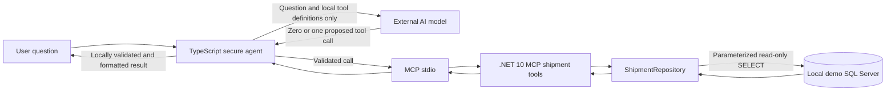
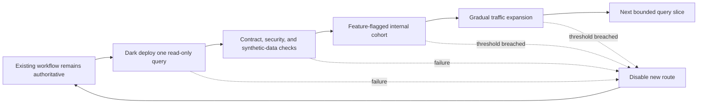

# Legacy Enterprise Integration Blueprint

## Purpose and scope

This document is an implementation-oriented portfolio blueprint for integrating this repository's .NET 10 MCP server and TypeScript secure AI agent with a hypothetical legacy .NET Framework or enterprise .NET application. It is not a production design and does not claim that the proposed enterprise components exist.

The terms in this document are deliberate:

- **Current** means implemented in this repository and supported by source or tests.
- **Proposed** means a target integration pattern that would require new implementation.
- **Enterprise decision** means a choice that cannot be made from this repository alone.

## Current architecture

The current solution is a local demonstration. A TypeScript agent sends the original user question plus locally controlled shipment function definitions to an external AI model. The model may select at most one function. The agent validates the MCP server's complete discovered tool set and exact accepted structural argument schemas, then separately validates the selected name, argument syntax, and local value bounds/enums before invoking the selected tool over MCP stdio. SQL-derived results return only to the local agent, where they are size-bounded, structurally validated, and formatted. They are not sent to the model.

The .NET 10 MCP process exposes exactly three read-only shipment tools: list up to 20 shipments, get one shipment by numeric ID, and list up to 20 shipments by one approved status. Tool input is bounded. `ShipmentRepository` uses fixed, parameterized `SELECT` statements through `Microsoft.Data.SqlClient`; there is no arbitrary SQL tool. A concurrency limit, tool deadline, SQL connection timeout, SQL command timeout, cancellation propagation, and sanitized failures bound execution. The configured SQL identity is external to the code; the repository documents a least-privilege local option, but the effective deployment identity remains an operator responsibility.



There is no legacy application, enterprise application service, Anti-Corruption Layer, network service boundary, tenant model, or enterprise authorization integration in the current repository.

## Proposed target architecture

For an enterprise integration, retain the .NET 10 MCP server as a separate process and replace its direct shipment database adapter with an adapter to an approved enterprise service boundary. The legacy application remains the system of record and the owner of shipment meaning, authorization, and business rules.

The proposed flow is:

1. A **PROPOSED trusted authentication/session host — NOT IMPLEMENTED** authenticates the user, establishes the authoritative principal and tenant independently of the question, and binds that identity context to the session and request.
2. The TypeScript agent continues to perform model-assisted selection against a fixed local contract; the model sees the question, not authority to create or change identity.
3. A proposed protected channel propagates the request-bound identity context alongside, but not inside, model-selected tool arguments to the .NET 10 MCP/application-service boundary.
4. The .NET 10 MCP tool maps the validated MCP request into a narrow query use case.
5. An Anti-Corruption Layer (ACL) translates the MCP-facing request and response into enterprise application concepts without leaking legacy types or database structures.
6. An application service owned by the legacy/enterprise system independently validates the workload and user/tenant context, authorizes the caller, and executes the query through existing domain and data-access paths.
7. The ACL maps the approved, minimal result into the stable MCP result contract.

```mermaid
flowchart LR
    U[Enterprise user or approved client] --> H[PROPOSED trusted authentication/session host<br/>NOT IMPLEMENTED]
    H -->|Authenticated request: question plus session-bound identity context| A[TypeScript secure agent with PROPOSED identity ingress]
    A -->|Question and local tool definitions| M[External AI model]
    M -->|Tool selection only| A
    A -->|Validated MCP call plus protected request-bound identity context<br/>PROPOSED, NOT IMPLEMENTED| P[.NET 10 MCP process]

    subgraph ModernizationBoundary[Proposed integration boundary]
        P --> Q[Query use-case port]
        Q --> ACL[Anti-Corruption Layer adapter]
        ACL --> SB[PROPOSED approved service boundary<br/>NOT IMPLEMENTED]
    end

    subgraph LegacySystem[Existing enterprise system of record]
        SB --> AS[PROPOSED legacy application service<br/>NOT IMPLEMENTED]
        AS --> AZ[Authorization and business rules]
        AZ --> DA[Existing approved data access]
        DA --> DB[(Enterprise database)]
    end

    DB --> DA --> AZ --> AS --> SB --> ACL --> Q --> P --> A
    A -->|Local validation and formatting| H
    H -->|Session-bound response| U
```



### Anti-Corruption Layer

The proposed ACL isolates two models that should evolve independently. On the MCP side, it accepts small query DTOs such as `ShipmentByIdQuery` and returns a minimal shipment projection. On the enterprise side, it calls the approved application-service contract and translates legacy identifiers, status codes, error categories, and null semantics.

The ACL must not reproduce business rules, infer authorization from model output, expose legacy entities, or translate arbitrary filters into SQL. Its responsibilities are contract translation, defensive validation, error mapping, and observability at the boundary. Any status mapping must be explicit and contract-tested; unknown legacy values fail closed rather than being silently coerced.

### Application Service and query-use-case boundary

Define narrow, read-only use cases such as `GetShipmentById` and `FindShipmentsByStatus`, with explicit maximum result sizes and cancellation/deadline inputs. The application service—not the MCP tool or model—owns authorization, tenant scoping, row-level policy, and invocation of existing business logic.

This boundary provides a stable port for the MCP process. Under Dependency Inversion, the MCP/query orchestration depends on an interface representing an approved query capability. A service client adapter implements that interface. The legacy application can expose the capability through an approved protocol without either side referencing the other's internal assemblies.

### Preserve the existing domain

The integration should call existing application services or introduce a thin query application service inside the legacy ownership boundary. It should not move or duplicate domain rules into prompts, TypeScript, MCP annotations, the ACL, or a second database repository. Existing rules for visibility, lifecycle status, tenant ownership, and field redaction remain authoritative.

Direct database reads from a new MCP identity are inappropriate when they bypass application authorization, row-level policy, calculated fields, lifecycle rules, or audit behavior. A database adapter is acceptable only if enterprise owners explicitly establish that the query is a supported application boundary and reproduce all required controls. The default proposal is the application-service path.

### .NET Framework interoperability

A .NET Framework application should not directly reference the .NET 10 MCP assembly. The target frameworks, runtime loaders, dependency graphs, hosting assumptions, and support lifecycles are different; an assembly reference would also couple legacy code to MCP hosting and transport concerns.

Keep the .NET 10 MCP server out of process. Connect it to the legacy application through an enterprise-approved service boundary such as a versioned HTTPS API, organization-approved RPC mechanism, or durable messaging pattern if asynchronous semantics are required. The protocol, authentication scheme, hosting platform, and network placement are enterprise decisions. For this read-only synchronous example, a versioned request/response API is the simplest conceptual fit.

## Concrete hypothetical shipment query

Suppose an authorized user asks, "Show pending shipments I am allowed to view." The authentication and identity steps below are proposed and are not implemented in the current demo.

1. The proposed trusted host authenticates the user, resolves the tenant from trusted enterprise state, and binds both to the session/request before the question reaches the agent.
2. The current TypeScript behavior sends that question and the three local tool definitions to the external model; the proposed identity context is not model input or a tool argument.
3. The model proposes `get_shipments_by_status` with `{ "status": "Pending" }`; it does not receive a shipment result.
4. The agent validates the exact call. In the proposed design, it invokes the .NET 10 MCP process with separately protected, request-bound identity context.
5. The MCP tool creates a `FindShipmentsByStatus` query using that context—not any identity claimed in natural language or model arguments.
6. The proposed ACL maps `Pending` to an approved enterprise status code and calls the legacy application service with workload authentication and the bound user/tenant context.
7. The application service independently validates identity/session binding, authorizes the end user or delegated identity, applies tenant and row-level scope, and invokes existing business/data-access logic.
8. The service returns only allowed fields and a bounded set. The ACL maps these to the MCP contract.
9. The local agent validates the result and formats it for the user. No SQL/MCP result is sent to the model.

```mermaid
sequenceDiagram
    actor User
    participant Host as PROPOSED trusted auth/session host (NOT IMPLEMENTED)
    participant Agent as TypeScript agent
    participant Model as External AI model
    participant MCP as .NET 10 MCP process
    participant ACL as Proposed ACL adapter
    participant App as Proposed legacy application service
    participant Rules as Existing authorization and business rules
    participant DB as Enterprise database

    User->>Host: Authenticate and submit shipment question
    Host->>Host: Establish principal and tenant; bind session/request
    Host->>Agent: Question plus protected request-bound identity context
    Agent->>Model: Original question and local tool definitions
    Model-->>Agent: Proposed tool name and arguments
    Agent->>Agent: Validate allowlist, schema, name, and arguments
    Agent->>MCP: Validated call plus protected identity context (PROPOSED)
    MCP->>ACL: Narrow query plus request-bound identity context
    ACL->>App: Versioned query, workload identity, and user/tenant context
    App->>App: Validate workload, identity, expiry, and session binding; fail closed
    App->>Rules: Independently authorize and apply tenant/row policy
    Rules->>DB: Approved read path
    DB-->>Rules: Scoped records
    Rules-->>App: Minimal authorized projection
    App-->>ACL: Versioned response
    ACL-->>MCP: MCP shipment result
    MCP-->>Agent: MCP result
    Agent->>Agent: Bound, validate, and format locally
    Agent-->>Host: Read-only answer bound to request/session
    Host-->>User: Session-bound response
    Note over Host,App: Identity infrastructure is PROPOSED and NOT IMPLEMENTED
    Note over Agent,Model: Identity context and SQL/MCP results never return to the model
```

## Identity and authorization

All identity infrastructure in this section is **PROPOSED and NOT IMPLEMENTED**. The current demo accepts a question in a local process and communicates with a local stdio child; it has no authentication/session host, tenant establishment, delegated-user context, or secure multi-user identity propagation.

A trusted authentication/session host must sit before the TypeScript agent. It authenticates the user through an enterprise-approved mechanism, resolves the authoritative principal and tenant from trusted session and directory/policy state independently of the question, and binds them to a specific session and request. The question is only untrusted request content. Natural-language text and model-selected tool names or arguments can neither establish nor override principal or tenant identity.

The host must propagate protected, request-bound identity context to the MCP/application-service boundary through a channel that the model cannot populate. Each hop must preserve session/request binding and prevent substitution, replay, or cross-request confusion. Workload authentication separately establishes that the MCP/ACL is an approved caller; end-user or delegated identity establishes on whose behalf it acts. The legacy application service must validate both contexts independently and enforce authorization, tenant isolation, row-level visibility, purpose/role policy, and field-level redaction before data leaves its boundary. It must not treat prior agent or MCP validation as an authorization decision.

Missing, invalid, expired, mismatched, or ambiguous principal, tenant, session binding, delegation, or workload context must fail closed before business data is returned. The service must also reject a valid principal paired with the wrong tenant or request/session. The concrete protocol, token format and issuer/audience/expiry validation, session-binding and replay controls, delegation model, workload identity, key storage/rotation, and network placement are enterprise-specific decisions requiring separate threat modeling and implementation.

The enterprise service and its database connection should use separate least-privilege identities. The MCP process should not hold a broad database credential. If a database identity is unavoidable, grant only the specific approved read capability and verify effective permissions in deployment. Administrative, owner, schema-wide, or write privileges are outside this blueprint.

## Failure handling, cancellation, deadlines, and retries

The current agent has bounded initialization, model, tool, overall, and shutdown stages; it forwards abort signals. The current MCP server adds a bounded concurrency gate, a tool deadline, SQL connection/command timeouts, and sanitized error mapping.

The proposed service boundary must preserve an absolute deadline or decreasing time budget and propagate cancellation where the selected protocol supports it. Each layer should reserve enough time to close resources and return a sanitized failure before the caller's deadline.

Retry ownership must be singular:

- The current agent may retry only eligible model-selection failures, at most once when configured. It does not retry MCP or SQL work.
- The MCP/ACL layer should not automatically retry enterprise queries unless the operation is demonstrably idempotent, the failure is transient, the deadline has budget, and the enterprise policy assigns retry ownership there.
- If the enterprise service client or service mesh owns retries, outer layers must disable duplicate retries to avoid amplification.
- Authorization failures, validation failures, contract mismatches, cancellations, and deadline exhaustion are never retried.

Failures should be categorized without returning raw database, network, stack, identity, or policy details to the user or model. A correlation identifier may connect sanitized events across boundaries; it must not encode user, tenant, shipment, question, or credential data.

## Strangler Fig rollout and rollback

Adopt the integration incrementally, leaving the existing user workflow authoritative until each slice is proven:

1. Define and contract-test one read-only query use case.
2. Deploy the enterprise application-service endpoint dark, with no user traffic.
3. Exercise it with synthetic or approved non-sensitive data and verify authorization/audit behavior.
4. Enable the MCP path for an internal allowlisted cohort behind an enterprise feature flag.
5. Expand gradually based on security, correctness, latency, and error-rate gates.
6. Add further read-only use cases one at a time; do not generalize to arbitrary query execution.

Rollback disables routing to the new query slice and returns users to the established workflow. Because the slice is read-only, rollback does not require data compensation. Contract versions and the previous adapter/server artifact must remain deployable until the observation window closes.



## Testing strategy

Retain the repository's existing unit tests for tool exposure, validation, result bounds, timeouts, cancellation, diagnostics, and model isolation. Add the following for a real integration:

- Consumer-driven contract tests for every supported client/server contract version.
- ACL mapping tests, including unknown status, missing field, oversized response, malformed response, and sanitized failure cases.
- Application-service tests proving user, tenant, row, and field authorization with allow and deny cases.
- Effective-identity and least-privilege tests in a production-like deployment environment.
- End-to-end tests with a fake model router and synthetic enterprise service; no external model is needed for business-path verification.
- Resilience tests for cancellation, deadline propagation, partial outages, slow dependencies, retry amplification, and rollback.
- Security tests for prompt injection, tool/schema substitution, confused-deputy identity, cross-tenant access, excessive data, and sensitive diagnostics.

## Deployment decision points

Before implementation, enterprise owners must decide:

- The approved service protocol, hosting topology, network zones, and service discovery.
- Workload and delegated-user authentication, token audience, credential storage, and rotation.
- Tenant source of truth, row/field authorization rules, and audit retention.
- The authoritative application service and whether its existing read path enforces all business rules.
- Contract ownership, supported versions, rollout gates, availability objectives, and retry owner.
- Data classification for user questions and returned fields, including whether any question may be sent to an external model.
- Rate limits, result limits, pagination semantics, caching policy, and regional/data-residency requirements.
- Operational ownership, incident response, support hours, and rollback authority.

Until these decisions and a threat model are approved, this design remains a proposed architecture exercise rather than production guidance.
